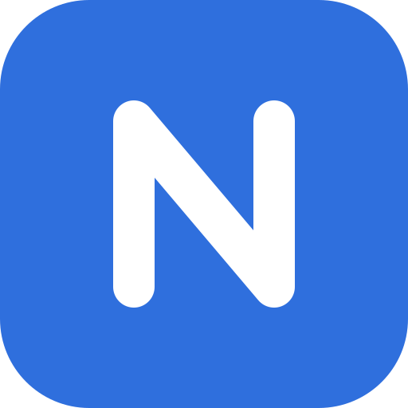
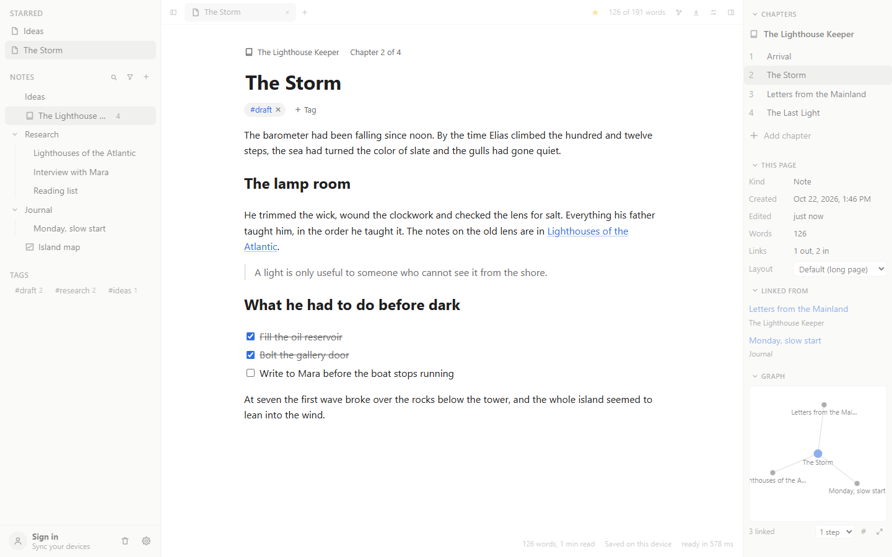
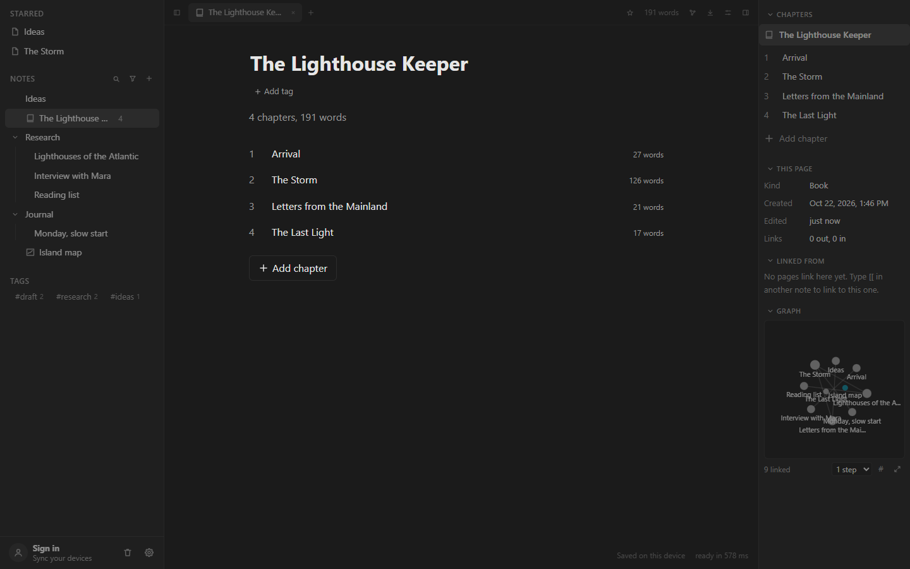
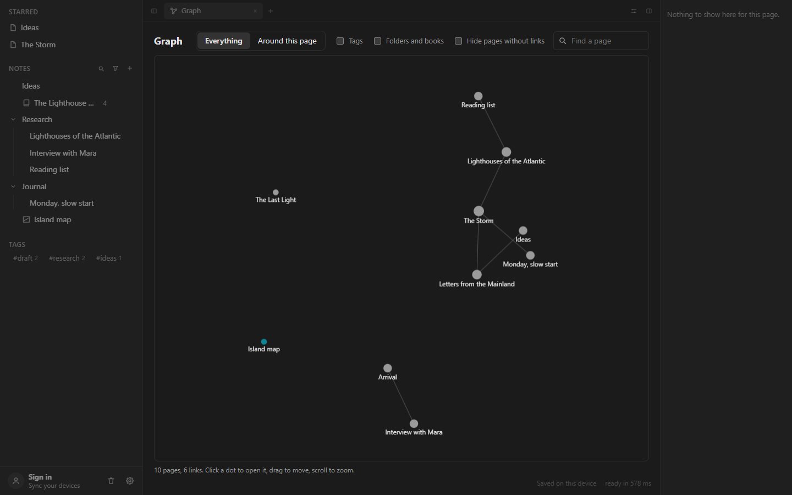
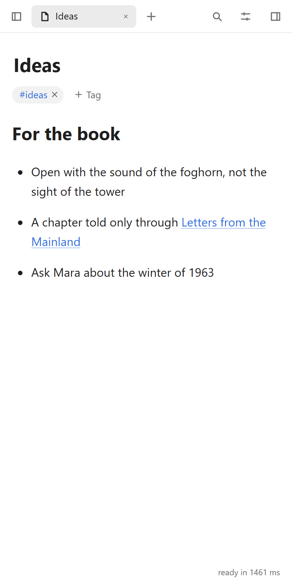

<p align="center">
  
</p>

<h1 align="center">Notemax</h1>

<p align="center">
  A note app for writing that grows into books.<br>
  Your notes live on your device, open instantly, and work offline.
</p>

<p align="center">
  <a href="https://notemax.pages.dev"><b>Open the web app</b></a>
  &nbsp;&nbsp;|&nbsp;&nbsp;
  <a href="#run-it-yourself">Run it yourself</a>
  &nbsp;&nbsp;|&nbsp;&nbsp;
  <a href="CHANGELOG.md">What's new</a>
</p>

<p align="center">
  <a href="https://github.com/vaibhavshiroorkar/notemax/actions/workflows/ci.yml"></a>
</p>



## Why Notemax

- **Local first.** Notes are saved on your device within a fraction of a second. No account needed, and everything works offline.
- **Made for long writing.** Notes become chapters, books gather them into parts, and a book downloads as Word, PDF or EPUB.
- **Fast with thousands of notes.** Startup, typing and switching pages are tested with 5,000 notes.
- **Yours to keep.** Optional sync goes through your own Google Drive, sealed with a passphrase so Google can't read it. Download everything as plain Markdown at any time.

## Features

**Write**
- A clean editor with headings, lists, to-dos, quotes, code and pictures. Type `/` for blocks, or use Markdown shortcuts.
- `[[Links]]` between notes. Renaming a note never breaks them, and each page lists what links to it.
- Show a note as one long page, or as A4 or Letter sheets with page numbers.
- Boards for sketching and diagrams, powered by Excalidraw.

**Organize**
- Folders, books and notes in one sidebar. Drag to sort, put pages inside pages, or pick several and move them together.
- Tabs, stars, tags, and a graph of how your pages connect.
- Ctrl+K finds any page or command. The sidebar can search, sort, group and filter.

**Keep it safe**
- A status bar that always says whether your work is saved.
- Version history for every note, undo for page changes, a trash you can search and restore from, and downloads as text, Markdown, HTML, Word, PDF, EPUB, PNG or SVG.
- Sync between devices through Google Drive, end-to-end encrypted.

**Make it yours**
- Light and dark themes, accent colors, fonts, text size and page width.
- Change any shortcut, hide features you don't use, or add [plugins](docs/plugins.md).
- Focus mode, quick settings (Ctrl+.) and a list of every shortcut (Ctrl+/).

<table>
  <tr>
    <td width="50%"></td>
    <td width="50%"></td>
  </tr>
  <tr>
    <td align="center">Books with chapters and word counts</td>
    <td align="center">A graph of your links</td>
  </tr>
</table>

<p align="center">
  
</p>

## Get Notemax

- **On the web:** open [notemax.pages.dev](https://notemax.pages.dev). It installs as an app on a phone or computer and works offline. Notes stay in that browser until you sign in to sync them.
- **On the desktop:** an app built with Tauri, tested on Windows so far. It keeps your notes in one file on disk, sits in the tray, and opens quick capture with Ctrl+Alt+N from any app. There is no installer to download yet, so build it from source for now.

## Run it yourself

You need Node 22 or newer and [pnpm](https://pnpm.io). The desktop app also needs Rust and the [Tauri prerequisites](https://tauri.app/start/prerequisites/).

```sh
pnpm install
pnpm dev             # web app at http://localhost:5173
pnpm desktop         # desktop app
pnpm test            # tests for the core package
pnpm typecheck
pnpm build           # production build of the web app
pnpm desktop:build   # desktop installer
```

Accounts and sync are optional. To try them, copy `apps/app/.env.example` to `apps/app/.env` and fill in your own Supabase project.

## How it's built

React, Tiptap and Yjs in the browser, wrapped by Tauri on the desktop. Every note is a Yjs document saved as an append-only log, which is what lets devices edit offline and merge later without losing text. Each feature is a plugin, built with the same API that outside plugins use.

See [docs/architecture.md](docs/architecture.md) for the layout of the code and [docs/plugins.md](docs/plugins.md) to write a plugin.

## Roadmap

- A smoother editor: Word-like formatting, faithful copy and paste from Word
- Version history, and plain Markdown files kept next to the database
- Live sync between open devices, then shared pages
- Split view, daily notes and a calendar
- Several workspaces with a home page
- Publishing a book as a fast public site

## Privacy

Notemax has no server that sees your notes. Read the [privacy policy](https://notemax.pages.dev/privacy) and [terms](https://notemax.pages.dev/terms).

## License

No license has been chosen yet, so all rights are reserved for now.
